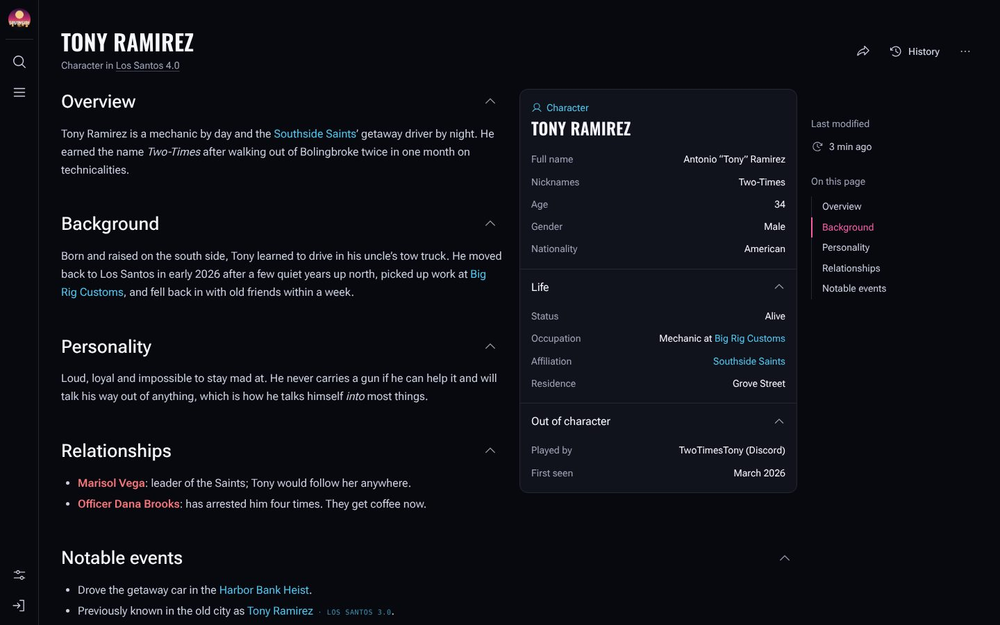
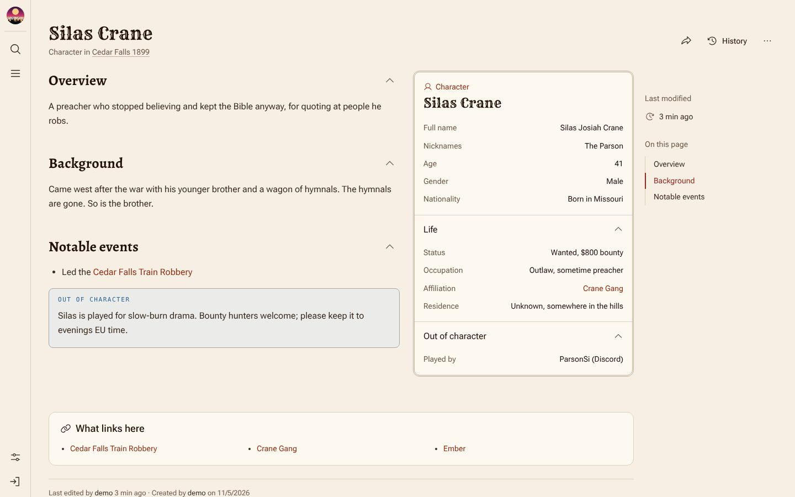
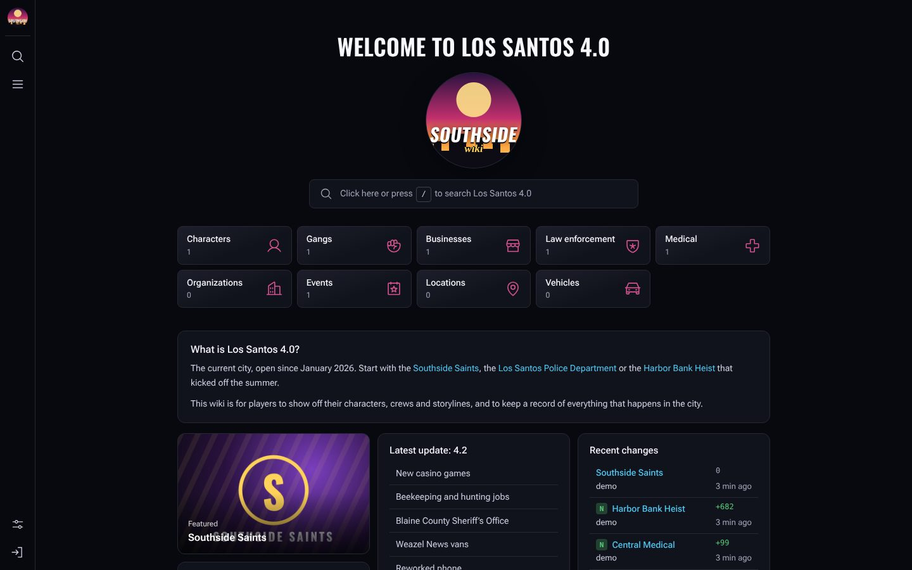
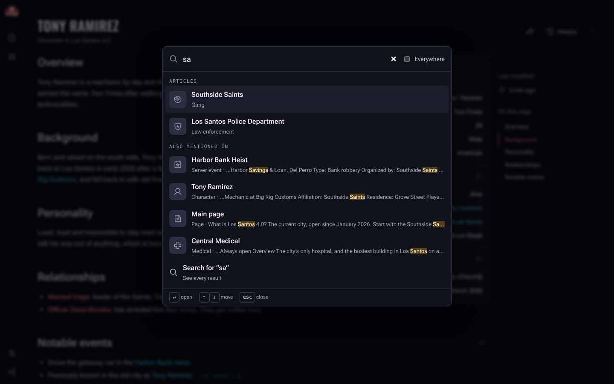
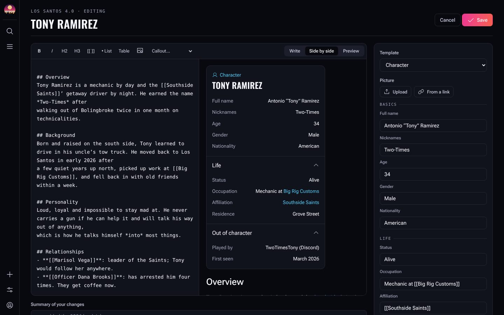
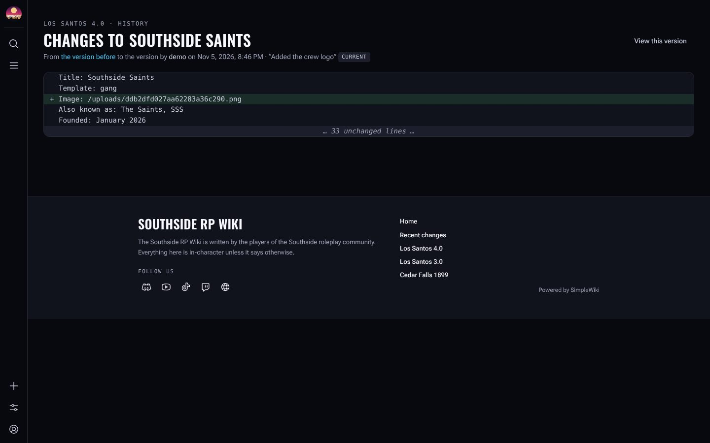

# SimpleWiki

**A wiki for your roleplay community.** It runs on your own server. Anyone who signs in with Discord can write, and admins and moderators keep it in order.

It's built for GTA and RDR roleplay servers. Characters, gangs, businesses, police, medical services and server events each get a ready-made template with an infobox. Each version of your server gets its own namespace, with its own look. Use one for the current city, another for the old one, and another for the Wild West server.



## Features

**Write**
- Articles from templates: **Character, Gang, Business, Law enforcement, Medical, Organization, Server event, Location, Vehicle, Horse** and a plain **Page**
- Each template has an infobox (portrait, sections, fields) and starter text, so new articles aren't a blank page
- Markdown with a toolbar and a live side-by-side preview. Paste or drop pictures straight into the text.
- `[[Links]]` between articles, with suggestions as you type. A link to an article nobody has written yet shows in red; click it to write that article.
- Out-of-character boxes (`> [!ooc]`), rumours, warnings and folded spoilers
- A table of contents, "What links here", and a **Wanted articles** list of red links waiting to be written

**Namespaces**
- One wiki, several worlds. For example, `gta` (the current city), `gta3` (the last one) and `rdr` (the Wild West server).
- Each namespace has its own articles, theme, main page, recent changes and search
- Link across namespaces with `[[gta3:Tony Ramirez]]`
- **Archive** an old version (readable, but only moderators can edit it) or **hide** a new one while you set it up

**Look and feel**
- A modern wiki layout in the style of the Citizen MediaWiki skin. There's a slim menu rail on the left (along the bottom on phones) with a drawer for navigation. Article titles stay at the top as you scroll, and an "On this page" column follows your reading.
- Search pops up over the page (press `/`) and shows matching articles as you type
- Infobox cards with a picture, foldable sections and foldable article sections
- Each wiki's front page has your logo, search, buttons for each kind of article, and a grid of cards: the featured article, stats, rules, links and the latest update. You edit those cards as ordinary Markdown.
- A site footer with your text and social links (Discord, YouTube, TikTok, Twitch…)

**Themes**
- **Los Santos (GTA):** night-time city, neon pink and sunset orange, condensed capitals
- **Frontier (RDR):** warm paper, ink and oxblood, with a slab-serif for titles
- **Classic:** cool blue-grey, and follows the device's light or dark setting
- Every namespace has a theme, so the old GTA city and the RDR server each look like themselves. Readers can override the theme for themselves.
- All themes share one layout, so adding a theme only means picking colours and fonts

**Sign in with Discord**
- The only way in: no passwords to manage or leak. The first sign-in makes the account, named after the person's Discord username.
- Optionally only members of your Discord server can sign in
- Discord roles can make people wiki moderators or admins, e.g. your staff role

**Moderate**
- Roles: **user**, **moderator** and **admin**. The first person to sign in becomes the admin.
- New accounts can be open to anyone, need a moderator's approval, or be closed to newcomers. The wiki can be public or for members only.
- Full history of every article, with diffs and one-click restore of any version
- Protect an article so only moderators (or admins) can edit it
- Delete and restore articles. Nothing is lost; deleted articles are hidden from everyone but moderators.
- Hide a single bad revision, such as one with personal info or abuse, from everyone but moderators
- Readers report problems; moderators work through the report queue
- Ban and unban accounts with a reason, and keep a moderation log of every action
- Admins edit the templates (fields, sections, starter text, which themes offer them) from the browser

**Share**
- Every article has its own address, like `/w/gta/tony-ramirez`
- Pasting a link into Discord shows a preview with the article's title, picture and opening lines

| | |
|---|---|
|  |  |
|  |  |
|  | |

## Running it

You need **Node.js 22.13 or newer**, and nothing else: there are no packages to install and nothing to build. The database is SQLite and is built into Node.

Everyone signs in with Discord, so first [make a Discord application](#signing-in-with-discord) (five minutes, free) to get a client id and secret. Then:

```sh
git clone https://github.com/Momijisu/SimpleWiki.git
cd SimpleWiki
cp .env.example .env      # on Windows: copy .env.example .env
```

Open `.env` in a text editor, paste in `DISCORD_CLIENT_ID` and `DISCORD_CLIENT_SECRET`, and save it. Then start the wiki:

```sh
npm start
```

Run `npm start` inside the `SimpleWiki` folder; anywhere else, npm can't find the wiki. Open http://localhost:8080 and **sign in straight away: the first person to sign in becomes the admin.** Then go to **Admin** to name your wiki, set up your namespaces and choose who can join.

To look around first, fill an empty wiki with example articles (a GTA city, an archived old city and an RDR town). Do this before your first sign-in:

```sh
npm run demo
npm start
```

The example articles are written by a "demo" account that nobody can sign in as. So sign in with Discord, then make yourself admin from the command line:

```sh
npm run role -- <your Discord username> admin
```

### With Docker

```sh
docker compose up -d
```

Edit `docker-compose.yml` first: set `PUBLIC_URL` to your wiki's address.

### On a real server

Put it behind a reverse proxy that adds HTTPS (Caddy, nginx or Cloudflare) and set `TRUST_PROXY=1`. [docs/DEPLOY.md](docs/DEPLOY.md) has a step-by-step guide, with configs for Caddy, nginx and systemd.

### Settings

| Variable | Default | |
|---|---|---|
| `PORT` | `8080` | Port to listen on |
| `HOST` | `0.0.0.0` | Address to listen on (`127.0.0.1` when behind a proxy on the same machine) |
| `DATA_DIR` | `./data` | Where the database and uploaded pictures live: **back this up** |
| `TRUST_PROXY` | off | Set to `1` behind a reverse proxy, so rate limits see real visitor addresses and cookies are marked secure |
| `PUBLIC_URL` | (from the request) | Your wiki's address, for link previews |
| `COOKIE_SECURE` | auto | `1` forces secure cookies; `0` turns them off |
| `DISCORD_CLIENT_ID`, `DISCORD_CLIENT_SECRET` | | **Required.** From your Discord application (see below) |
| `DISCORD_GUILD_ID` | | Only members of this Discord server can sign in |
| `DISCORD_MOD_ROLE_IDS`, `DISCORD_ADMIN_ROLE_IDS` | | Discord role ids, separated by commas, that make someone a wiki moderator or admin |

These go in `.env` (see [.env.example](.env.example)), or are set as normal environment variables. Everything else, such as the wiki's name, who can join, read access, namespaces and templates, is set in the browser under **Admin**.

### Signing in with Discord

1. Go to the [Discord Developer Portal](https://discord.com/developers/applications) and choose **New Application**. Name it after your wiki; players see this name when they sign in.
2. Open **OAuth2**. Copy the **Client ID**, then **Reset Secret** and copy the **Client Secret**.
3. Under **Redirects**, add your wiki's address followed by `/auth/discord/callback`, e.g. `https://wiki.example.com/auth/discord/callback`. It has to match exactly, so set `PUBLIC_URL` to the same address. For local testing use `http://localhost:8080/auth/discord/callback`.
4. Put the two values in `.env` (and, on a real server, set `PUBLIC_URL` to the wiki's address), then `npm start`.
   Without them nobody can sign in. The server says so when it starts, and the sign-in page says so too.

Optional extras:

- **Only your community:** turn on *Developer Mode* in Discord (Settings → Advanced), right-click your server and choose **Copy Server ID**, then set `DISCORD_GUILD_ID` to it. People who aren't in the server are turned away, and so are new members who haven't passed membership screening yet.
- **Staff become moderators:** with `DISCORD_GUILD_ID` set, right-click a role (Server Settings → Roles) and choose **Copy Role ID**. List the ids in `DISCORD_MOD_ROLE_IDS` or `DISCORD_ADMIN_ROLE_IDS`, separated by commas. Roles are checked each time someone signs in. If they lose the Discord role, they lose the wiki role too. A role an admin gives someone by hand in the wiki is never taken away by Discord.

How it behaves:

- The first sign-in makes the account. Its username comes from the person's Discord username, adjusted if it's already taken. Your setting for new accounts applies: open, approval or closed.
- Banning someone bans their Discord account. Making a new wiki account needs a different Discord account.
- Only moderators, and the person themselves, can see which Discord account a wiki account belongs to. Moderators can search for people by Discord name or id.
- The wiki only asks Discord for the person's name and avatar, plus their roles in your server when `DISCORD_GUILD_ID` is set. It never posts anything and doesn't keep Discord's access token.

### Giving someone a role from the server

If the only admin leaves, or you want to set roles before your Discord roles are sorted, run this where the database is:

```sh
DATA_DIR=./data npm run role                      # list moderators and admins
DATA_DIR=./data npm run role -- tony admin        # by wiki name, Discord name or Discord id
```

The person needs to have signed in once. Normally you change roles in the browser under Moderation → People.

### Backups

Everything lives in `DATA_DIR`: `wiki.db` and the `uploads` folder. This command makes a safe copy while the wiki is running:

```sh
DATA_DIR=./data npm run backup -- /path/to/backups
```

## Writing

| Type this | To get |
|---|---|
| `[[Tony Ramirez]]` | a link to an article (red if it doesn't exist yet) |
| `[[Tony Ramirez\|Tony]]` | a link with different text |
| `[[gta3:Tony Ramirez]]` | a link into another namespace |
| `## Background` | a section; three or more make a table of contents |
| `> [!ooc]` | an out-of-character box; also `note`, `warning`, `rumor` and `secret` (folded) |
| `` | a picture. Paste or drop one into the editor to upload it. |
| `\| a \| b \|` | a table, as in GitHub Markdown |

### Front pages

An article called **Main page** fills its namespace's front page. Its first part (or first `## Heading`) is the introduction across the top. Every other `## Heading` becomes a card in the grid below. A list that's only links turns into a column of buttons, which suits "Official links". For example:

```markdown
## What is Los Santos 4.0?
The current city, open since January 2026…

## Wiki rules
- Everything here is out-of-character information.
- Don't edit-war: talk to a moderator on Discord.

## Official links
- [Discord](https://discord.gg/…)
- [Server rules](https://…)
```

Protect the Main page (More → Protection) so only moderators can change it. Moderators can also pick a **featured article** from any article's More menu.

The site's own front page works the same way, with its text under Admin → Site. The logo, footer text and footer links are set there too.

## Extending it

- **More namespaces:** go to Admin → Namespaces → *Add a namespace*. Give it a short name (`gta5`), a name, a tagline and a theme.
- **More templates:** go to Admin → Templates → *Add a template*. Set its infobox sections as `Section: Field, Field, Field`, its starter text, and which themes offer it.
- **A new theme:** copy a block in [public/css/themes.css](public/css/themes.css), change the colours and fonts, and add its name to `THEMES` in [server/api.js](server/api.js).

## Development

```sh
npm run dev    # restarts when server files change
npm test       # API tests against a fake Discord: sign-in, permissions, moderation, links, uploads
```

| Folder | What's there |
|---|---|
| `server/` | The HTTP server (`index.js`), the JSON API (`api.js`), the database (`db.js`), Discord sign-in (`discord.js`), sessions (`auth.js`), the starter templates |
| `public/` | The app: plain ES modules, no build step. `js/views/` has one file per kind of page; `css/themes.css` holds the themes. |
| `tools/` | Demo content, backups and the `role` command |

### Security notes

- There are no passwords: Discord vouches for who people are. Sign-in uses OAuth2 with a one-time state tied to a cookie. The session cookie is HttpOnly and SameSite, and only a hash of it is stored.
- Every change needs a custom request header, which blocks cross-site request forgery. A strict Content-Security-Policy is sent on every response.
- Markdown is cleaned with DOMPurify before it's shown. Uploads must really be PNG, JPEG, GIF or WebP, are renamed at random, and are served with `nosniff`.
- Sign-in, editing, uploads and reports are rate-limited.

## License

MIT, see [LICENSE](LICENSE). Bundled fonts are under the SIL Open Font License: Roboto Flex, Oswald, Rye and Alegreya (see `public/fonts`). The layout is inspired by the [Citizen](https://github.com/StarCitizenTools/mediawiki-skins-Citizen) MediaWiki skin; no code from it is included. Icons come from [Phosphor](https://phosphoricons.com) (MIT). The bundled libraries are [marked](https://marked.js.org) (MIT) and [DOMPurify](https://github.com/cure53/DOMPurify) (Apache 2.0 / MPL 2.0).

The themes are inspired by the general mood of crime-city and Wild West games. SimpleWiki isn't affiliated with or endorsed by Rockstar Games, and uses none of their artwork, fonts or logos.
